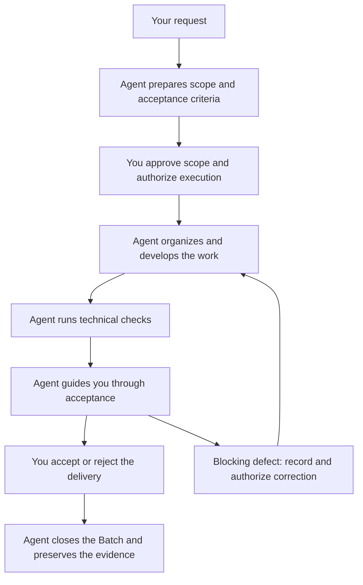

# 🧠 Kanban Rememory

**You bring the intent. The agents do the work. The repository remembers.**

Kanban Rememory is a Git and Markdown framework for running software projects with AI agents. It gives them a shared way to understand requests, organize work, implement changes, verify results, and preserve enough context to continue across sessions.

Think of it as a little workshop inside your repository, staffed by agents with a shared notebook. A request goes in. They organize the work and bring back a delivery you can test, the evidence behind it, and any decisions they need from you. The notebook survives the next “Hello! How can I help you today?”

You explain what you want, approve the scope, and judge the result. **The agents write the records and maintain the board.** Every Card is created and maintained by the Development Agent.

You get to build your project. The AI gets the paperwork. A small victory for humanity.

[Get started](docs/getting-started.md) · [Read the manifesto](docs/lean-specifications.md) · [See a complete example](docs/batches/delivery-example.md)

## Why this box exists: enthusiasm needed adult supervision

You ask for a form. You get two extra buttons, a settings screen, and a cheerful explanation of why you needed them. You ask to test it. The agent forgets to tell you which build to open. A new session starts. Time to explain the whole bloody project again.

Congratulations. You are now the project's human RAM.

Kanban Rememory grew out of that frustration. The project needs an answer to a few persistent questions: what did we agree to build, who is doing what, what actually passed, and what happens next?

The answers live alongside the code. An agent can read them, resume authorized work, and leave a useful handoff. You can inspect them whenever you want.

Less chat archaeology. More software you can actually use.

## The guiding principles: every feature pays rent

- **Every feature pays rent.** Every requirement needs a clear benefit: experience, usability, performance, or a necessary protection. Even that adorable little extra button.
- **“While I was at it…” needs permission.** Agents can suggest improvements. Adding behavior requires your agreement. An active Batch keeps its approved scope.
- **Let the agents carry the clipboard.** They break down work, manage Cards, check dependencies, write code, and maintain evidence within their authorization. They ask when a decision belongs to you or the expected behavior is unclear.
- **“Done” comes with evidence.** Acceptance criteria describe observable results. Tests identify the revision they checked. Confidence and a sparkle emoji will only get you so far.
- **Bugs get names and follow-ups.** Every observed defect becomes debt. Blocking defects require correction before acceptance; deferred debt and outstanding tests remain traceable. Sweeping them under the next Batch gets expensive.
- **Know when to stop.** Reuse what works, preserve required protections, and stop when the agreed outcome is achieved and verified. Resist the encore.

**Be lazy about writing unnecessary code. Be stubborn about delivering what was agreed.** The [Lean Specifications manifesto](docs/lean-specifications.md) is the full reference.

## The pieces of the puzzle

Open the box. Here is what keeps the work together. The agents maintain these pieces; you can inspect them whenever curiosity or suspicion strikes.

| Piece | What it does | How it connects |
| --- | --- | --- |
| **Specifications** | Describe the intended outcome, scope, acceptance criteria, and any binding mockups or resources. | A Batch selects exact approved revisions. |
| **Batches** | Define a delivery: one or more approved Specifications, priorities, tests, a report, and your final decision. | Keep the scope fixed while implementation and acceptance progress. |
| **Cards** | Track the Development Agent's executable tasks, dependencies, blockers, and completion evidence. | Can reference a Batch and Specifications; standalone Cards need neither. |
| **Tests and reports** | Preserve tested revisions, results, screenshots, defects, decisions, and closure evidence. | Belong to their Batch and make its delivery reviewable. |
| **Rememory** | Keep a concise journal of decisions, verified milestones, and next actions. | Give the next agent the context needed to resume the work. |
| **Instructions and tools** | Define agent responsibilities and provide commands to create, move, display, and validate Cards, plus Batch checks. | Help agents maintain consistent records and follow the agreed workflow. |

The records live under `project/specs/`, `project/batches/`, `project/kanban/`, and `project/rememory/`. Guides and templates live in `docs/`; executable tools live in `tools/`.

**A Batch groups Specifications. Cards track execution independently.** A Card can point to a Batch; the Batch does not contain Cards. Its report describes the delivery and its evidence.

Stable IDs connect related records. Approved Specification revisions pin the expected behavior. Test results identify the candidate that was checked. Shared resources stay associated with their Specifications through the approval snapshot and resource archives. Git preserves the history; Rememory explains the decisions and next steps.

Start with Cards and Rememory. Add the optional Specification and Batch module when you need a formal agreement about a delivery and its acceptance. A small standalone task can remain a small standalone task. Keep the ceremony proportional.

## How the work runs

Two AI roles share the work. The **Specification Agent** helps you turn “I want this” into agreed behavior and guides acceptance. The **Development Agent** implements, tests, maintains Cards, and handles authorized Git operations. The same AI can wear both hats at different stages. It still has to remember which one is on.

With the Batch module, the delivery loop looks like this:

**1. Bring the idea. The agent brings the questions.** The Specification Agent helps clarify what should change, writes the Specification, and proposes concrete acceptance criteria. Suggestions stay separate until agreed. You approve the scope; the agent records it in a Batch.

**2. The Development Agent takes it from there.** Once execution is authorized, it creates its own Cards, checks dependencies and capacity, and implements the work. Cards move through the configured stages. Their folders show the stage; their contents show progress, waiting, or blockers. The agent records technical choices and verification evidence as it works.

**3. You get a candidate you can actually test.** The agent identifies the revision and build, prepares the environment instructions, and presents acceptance cases one at a time. Each case includes startup instructions, actions, expected results, and an OK / KO choice. The agent records your verdict and proceeds to the next case. For a KO, it asks what happened and collects a screenshot when available.

**4. Bugs get a return ticket.** A blocking defect returns the open Batch to correction within its approved scope. Earlier results stay attached to their tested revisions. A new candidate brings another check of the failing, affected, and previously blocked scenarios. Nonblocking debt can be deferred explicitly; required tests still need to pass before acceptance. An unexecuted test stays unexecuted, however optimistic the room feels.

**5. You decide; the agent closes.** After acceptance, the Development Agent merges the tested work and records closure under the project's Git permissions. After rejection, it archives the code and preserves the report, debt, and outstanding tests in the closing records. A later delivery can pick up those obligations without starting from amnesia.

For standalone work, the approved outcome and checks live directly on the Card. The Development Agent follows the same discipline of authorization, implementation, verification, and recorded evidence under the project's delivery rules.

## You build the project. The agents keep the thread.

You can ask for a feature, describe a bug, clarify a priority, or ask where the project stands. The agents translate that conversation into the appropriate records and bring back the information needed for your next decision.

You get scope you can review before development, visible progress and blockers during it, guided tests when a delivery is ready, and a record of what remains afterward. Ambiguous behavior becomes a question; the agent pauses the affected work rather than inventing an answer.

When a session ends or another agent takes over, the work remains in the repository. The next agent reads the current state, checks the evidence and permissions, and resumes the next authorized action. Everyone appreciates skipping the three-hour recap. New requests arriving during an active delivery are recorded and queued according to the workflow.

The aim is autonomy within agreed boundaries. You keep product decisions. Agents keep the paperwork and execution moving. Future you has suffered enough.

## Bring your repo. We'll bring the notebook.

Give an agent access to your Git repository and the [getting started guide](docs/getting-started.md). It installs the reusable files, guides you through a short, standard, long, or custom workflow, and applies the configuration you approve. The tools require Git and Python 3.9 or later.

Today, agents execute the workflow through project instructions and tools in their sessions. The repository supplies the memory, rules, and checks; a separate scheduler must invoke an agent for unattended runs. Automated Batch dispatch still needs implementation.

**Kanban Rememory Runner (KRR)** is the native Swift macOS companion for managing Codex and Claude Code watchers. Its current watchers request a read-only board summary. The [KRR startup guide](docs/runner/getting-started.md) explains how to build and run it. The framework works independently of the app.

We use Kanban Rememory to build Kanban Rememory. Yes, the box is building the box. We also live with its rough edges, which is an excellent cure for optimistic documentation. This repository's Cards and delivery records are its own history; the installation guide identifies the reusable pieces for yours.

## Pick your next move

| You want to… | Start here |
| --- | --- |
| Adopt the framework with your agent | [Getting started](docs/getting-started.md) |
| Understand the board | [Kanban guide](docs/kanban/board-guide.md) |
| Understand what the agent records on a Card | [Card guide](docs/kanban/write-task-cards.md) |
| Keep scope lean | [The manifesto](docs/lean-specifications.md) |
| Understand deliveries and acceptance | [Specification and Batch workflow](docs/batches/batch-workflow.md) |
| See connected records with examples | [Worked delivery example](docs/batches/delivery-example.md) |
| Run the macOS companion | [KRR getting started](docs/runner/getting-started.md) |
| Find where things belong | [Directory template](docs/templates/project-layout.md) |
