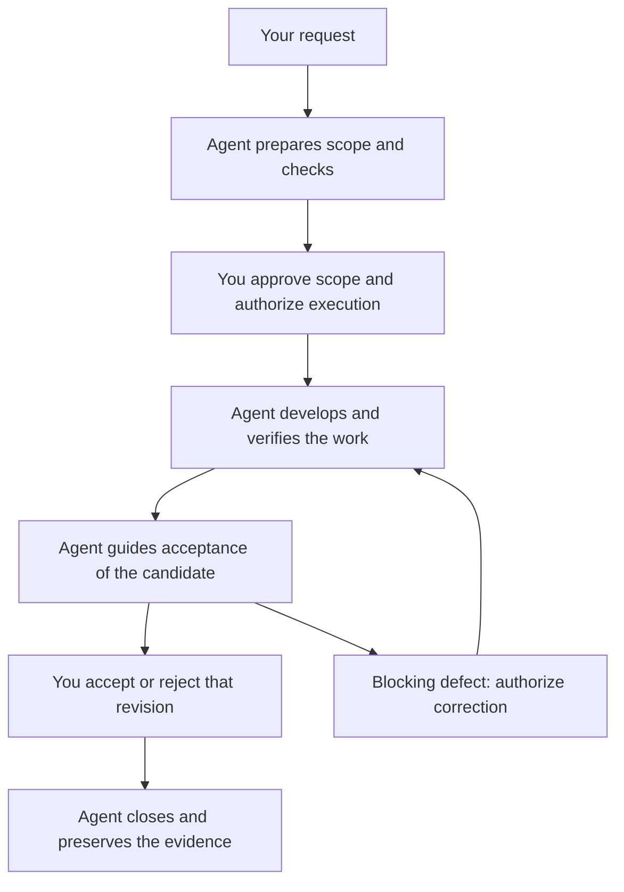

# 🧠 Kanban Rememory

**You bring the intent. The agents do the work. The repository remembers.**

Kanban Rememory is a Git and Markdown framework for running software projects with AI agents. It gives them a shared way to understand requests, organize work, implement changes, verify results, and continue across sessions.

You explain what you want, approve the scope, authorize work and judge the result. **The agents write the records and maintain the board.**

[Read the guides](documentation/index.md) · [Start a project](documentation/start-a-project.md) · [Read the manifesto](documentation/lean-specifications.md)

## Why this box exists

You ask for a form. You get two extra buttons, a settings screen, and a cheerful explanation of why you needed them. You ask to test it. The agent forgets to tell you which build to open. A new session starts. Time to explain the whole bloody project again.

Congratulations. You are now the project's human RAM.

Kanban Rememory keeps agreed behavior, work state and evidence beside the code. Agents can resume authorized work and leave a useful handoff. You can inspect the records. Less chat archaeology; more software you can use.

## The guiding principles: every feature pays rent

The [Lean Specifications manifesto](documentation/lean-specifications.md) sets the shared principles:

- **Start with the outcome.** Explain who needs to achieve what and how success will be checked.
- **Make each requirement earn its place.** Keep behavior that provides value or necessary protection.
- **Specify the smallest complete experience.** Include relevant failure recovery and binding mockup details. Ambiguous behavior becomes a question.
- **Give requirements a way to pass or fail.** Observable criteria and evidence identify what was checked and on which revision.
- **Change scope only by agreement.** Suggestions stay separate; the approved baseline of an active Batch stays fixed. Every observed defect remains debt until its correction is verified.
- **Build the simplest thing that meets the criteria.** Reuse what works, preserve required protections, and stop when the agreed outcome is verified.

## The records that keep the work together

Start with **Cards and Rememory**. Add the optional Specification and Batch module when you need a formal agreement about a delivery and its acceptance. A small standalone task can remain a small standalone task.

| Record | What it preserves |
| --- | --- |
| **Card** | An executable task, its outcome, scope, dependencies and completion evidence. It can reference a Specification or Batch. |
| **Rememory** | A concise journal of decisions, verified milestones, blockers and the next authorized action. |
| **Specification** | Intended behavior, acceptance criteria, constraints and any binding mockups or resources. |
| **Batch** | A delivery selecting exact approved Specifications, with priorities, tests, a report and your final decision. |
| **Tests and report** | The tested candidate, results, defects, outstanding checks, decisions and closure evidence for that Batch. |

**A Batch groups Specifications. Cards track execution independently.** A Card can point to a Batch; Batch records do not contain Cards. Stable IDs connect the records, Git preserves their history, and Rememory explains the decisions and next steps.

Follow [one complete fictional delivery](documentation/index.md#a-complete-example) through its connected records, failed test, correction and accepted closure.

## One project board, with or without modules

Choose a simple project or a multi-module project during setup. Both use one Kanban in `project/kanban/` and one project journal in `project/rememory/` for shared decisions and verified publication milestones.

In a multi-module project, `project.json` declares the workspaces. Cards stay on the project board, where you can filter them by module. Each workspace has its own `rememory/` and, when enabled, `specifications/` and `batches/`. See [Start a project](documentation/start-a-project.md) for the setup choices.

## One chat, distinct responsibilities

Open a normal Codex or Claude Code chat in an adopted project. **KR Orchestrator** starts by default and keeps decisions and handoffs in that chat. Explicitly selected roles and assigned subagents retain their roles.

The Orchestrator handles **KR Writer** duties to clarify scope and prepare Specifications and backlog Cards. It delegates implementation, technical checks, Card execution records and authorized Git operations to **KR Developer**. **KR Tester** runs and guides acceptance for the exact delivered candidate. Each role keeps its own authority. The skills are `kr-orchestrator`, `kr-writer`, `kr-developer` and `kr-tester`.

For example:

> Fix the setup guide's broken links without changing its instructions. Verify local targets and report the result. Execute using the project's existing publication permissions.

The agent checks existing work, dependencies and capacity, and asks about missing decisions that affect the result. Agreement on scope, permission to implement, acceptance and publication are distinct; one instruction can grant several together, and recorded standing permissions remain usable.

## From approved scope to verified delivery

For a standalone task, its approved outcome and checks live on the Card. For Batch work, the delivery follows this loop:

You receive the exact revision, startup instructions and acceptance cases with an OK / KO choice. The agent records your observations, keeps previous attempts and guides the next independent case. A case verdict and your final delivery decision are separate.

Blocking defects require correction before acceptance. Required scenarios must pass; nonblocking debt may remain only with an explicit deferral. Accepted work is merged and published under the project's Git permissions. Rejected code is archived while the records preserve defects and tests still owed. Closed records remain historical evidence; later work carries unresolved obligations forward.

For the full path, read [Deliver a Batch](documentation/deliver-a-batch.md) and [Test and accept a Batch](documentation/test-and-accept-a-batch.md).

## Pick your next move

[Start a project](documentation/start-a-project.md) with your agent. It checks prerequisites, proposes a short, standard, long or custom workflow, then installs and verifies the approved setup. The tools require Git and Python 3.9 or later.

Agent sessions execute the kit instructions and checks. Unattended runs need a separate scheduler; automated Batch dispatch still needs implementation. Installing the kit starts no background development service.

This repository uses the same Cards and records to develop the kit; your agent installs the reusable pieces in yours.

The [guide index](documentation/index.md) routes requests, resumption, defects and switching assistants. Human guides live in `documentation/`; the separate [agent index](agents/index.md) routes operating instructions and templates.
